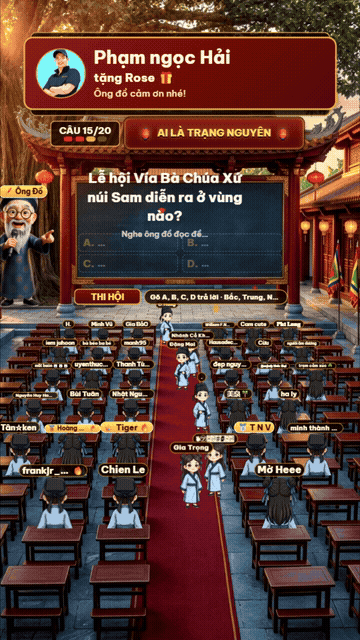

# 🌱 HỒ SƠ GIỚI THIỆU SẢN PHẨM & CÔNG NGHỆ: LiveTrangNguyen (v2.0)

  

> **Khẩu hiệu (Tagline):** *"Khoa Cử Thời Số Hóa — Game Show Đố Vui Tương Tác TikTok LIVE Tự Động 100% Cùng Ông Đồ AI"*  
> **Nền tảng hỗ trợ:** Windows 10/11 · Node.js + React 19 + TikTok LIVE Studio (`1080 × 1920`)  
> **Tác giả & Website chính thức:** **Duong Birken** — [https://duongbirken.deta.vn](https://duongbirken.deta.vn)  
> **Kho mã nguồn & Tải về:** [https://github.com/duongbirken2510/Live-TrangNguyen](https://github.com/duongbirken2510/Live-TrangNguyen)

---

## 📑 Mục Lục Nhanh
1. [LiveTrangNguyen là gì?](#1-livetrangnguyen-là-gì)
2. [Các Tính Năng Chính Cung Cấp Cho Người Dùng](#2-các-tính-năng-chính-cung-cấp-cho-người-dùng)
3. [Lợi Ích Mang Lại — Giải Quyết Những "Nỗi Đau" Gì?](#3-lợi-ích-mang-lại-giải-quyết-triệt-để-những-nỗi-đau-gì)
4. [Kịch Bản Thực Tế: Một Phiên Phát Sóng Tiêu Biểu](#4-kịch-bản-thực-tế-một-phiên-phát-sóng-tiêu-biểu)
5. [Kỹ Thuật & Công Nghệ Chuyên Sâu Bên Dưới](#5-kỹ-thuật--công-nghệ-chuyên-sâu-bên-dưới)
6. [Hiệu Quả Công Nghệ & Trải Nghiệm Người Dùng](#6-hiệu-quả-công-nghệ--trải-nghiệm-người-dùng)
7. [Cam Kết Quyền Riêng Tư & An Toàn Nội Dung Phát Sóng](#7-cam-kết-quyền-riêng-tư--an-toàn-nội-dung-phát-sóng)
8. [Thư Viện Hình Ảnh Giao Diện & 4 Bối Cảnh Khoa Cử](#8-thư-viện-hình-ảnh-giao-diện--4-bối-cảnh-khoa-cử)
9. [Cấu Hình Yêu Cầu & Câu Hỏi Thường Gặp (FAQ)](#9-cấu-hình-yêu-cầu--câu-hỏi-thường-gặp-faq)
10. [Lộ Trình Phát Triển Tiếp Theo & Liên Hệ Tác Giả](#10-lộ-trình-phát-triển-tiếp-theo--liên-hệ-tác-giả)

---

## 1. LiveTrangNguyen là gì?

**LiveTrangNguyen (`Ai Là Trạng Nguyên`)** là hệ thống game show đố vui tương tác thời gian thực dành riêng cho **TikTok LIVE**, tái hiện sống động hành trình khoa cử phong kiến Việt Nam qua 4 kỳ thi: **Khảo Hạch Trường Làng ➔ Thi Hương ➔ Thi Hội ➔ Thi Đình**.

- **Đối tượng người dùng mục tiêu:** Các nhà sáng tạo nội dung (Creators/Streamers) trên TikTok muốn vận hành kênh phát trực tiếp tương tác cao 24/7 mà không cần người dẫn chương trình ngồi trước ống kính liên tục.
- **Triết lý thiết kế cốt lõi:**
  1. **Tự động hóa 100% nhưng giàu cảm xúc con người:** Nhân vật Ông Đồ tự động đọc đề, công bố đáp án, cười vui, thở dài, trêu đùa khán giả và cảm ơn quà tặng bằng giọng AI tiếng Việt tự nhiên (**VieNeu-TTS v3 Turbo** với giọng `"Adam bựa"` và 25 giọng vùng miền).
  2. **Thăng cấp thị giác theo từng vòng thi:** Giữ nguyên tuyệt đối tọa độ bảng đen và 31 bàn sĩ tử nhưng nâng cấp toàn bộ kiến trúc, trang phục nhân vật và hiệu ứng lá/hoa/sao lấp lánh qua 4 kỳ thi.
  3. **Công bằng tới từng mili-giây & Tuân thủ tuyệt đối chính sách TikTok:** Chấm điểm theo dấu thời gian gốc của máy chủ TikTok (`createTime`), quà tặng chỉ vinh danh băng rôn chứ không mua điểm số, và tuyệt đối không đọc nguyên văn bình luận tránh vi phạm tiêu chuẩn cộng đồng.

---

## 2. Các Tính Năng Chính Cung Cấp Cho Người Dùng

| Nhóm tính năng | Chi tiết trải nghiệm cung cấp cho người dùng |
| :--- | :--- |
| **1. Hệ thống 4 Kỳ Khoa Cử & Thăng Cấp Bối Cảnh (`GameStage.tsx`)** | • Mỗi ván 20 câu chia làm 4 kỳ thi (mỗi kỳ 5 câu): **Khảo Hạch Trường Làng** (`nen2.jpg`), **Thi Hương** (`nen-huong.jpg`), **Thi Hội - Văn Miếu** (`nen-hoi.jpg`), **Thi Đình - Sân Rồng Hoàng Cung** (`nen-dinh.jpg`). • Hiệu ứng thiên nhiên đổi theo vòng: Lá đa xanh ➔ Lá thu vàng ➔ Cánh hoa trạng nguyên ➔ Kim diệp & đom đóm hoàng kim. • Nhân vật sân thi tự động nâng cấp từ trẻ mục đồng & dân làng ở Kỳ 1 sang sĩ tử nho sinh khăn đóng áo dài ở Kỳ 2–4. |
| **2. Giọng Đọc AI VieNeu-TTS Nhúng Trực Tiếp (`vieneu-worker.py`)** | • Tích hợp trực tiếp mô hình **VieNeu-TTS v3 Turbo (`onnx_int8`)** chạy ngầm qua đường ống nhị phân `stdio`, không cần mở cửa sổ CMD thứ 2 và không xung đột cổng mạng. • Cung cấp **25 giọng đọc AI tiếng Việt** (mặc định `"Adam bựa"`) chọn trực tiếp trên Dashboard, kèm cơ chế tự động chuyển đổi dự phòng sang **Microsoft Edge TTS (`NamMinh`)** và **Google TTS**. |
| **3. Quản Lý 31 Bàn Thi Thông Minh (`thi.ts`)** | • **Vào bàn mọi tương tác:** Người xem vào phòng (`member`), bình luận (`chat`), thả tim (`like`), tặng quà (`gift`) hoặc `follow` đều được xếp vào bàn trống ngay lập tức. • **Tự động lọc người treo máy (Quy tắc 1):** Sĩ tử đang `0 điểm` mà suốt **5 câu liên tiếp** không trả lời và không tương tác sẽ tự động rời ghế để nhường chỗ cho người xem mới. • **Dọn sạch bàn khi sang ván mới (Quy tắc 2):** Khi kết thúc màn Vinh Quy Bái Tổ về lại Vòng 1 (hoặc bấm **Bắt đầu ván mới ngay** / **Reset game**), toàn bộ 31 ghế và lối đi được làm mới hoàn toàn. |
| **4. Kho 5.000 Câu Hỏi 14 Chủ Đề + Toán Nhẩm Động** | • Gần 5.000 câu hỏi biên soạn sẵn thuộc 14 chủ đề văn hóa, lịch sử, địa lý, ca dao, khoa học, đố mẹo chia theo 5 mức độ khó (`de`, `vua`, `kho`, `dinh`, `meo`). • Tự động sinh câu hỏi toán nhẩm (`sinhToan`) ở câu thứ 3 của mỗi kỳ thi và lưu lịch sử câu đã hỏi vào `data/da-hoi.json` để không lặp lại câu cũ. |
| **5. Thi Đua 3 Miền, Cứu Trợ Tim & Vinh Quy Bái Tổ** | • Khán giả gõ `Bắc`, `Trung`, `Nam` để gia nhập đội tuyển miền; điểm cá nhân cộng dồn vào bảng điểm 3 miền. • Ở kỳ **Thi Đình**, cả phòng thả đủ **200 tim ❤️** trong một câu hỏi sẽ kích hoạt quyền cứu trợ loại bỏ 2 đáp án sai (`50/50`). • Cuối ván sắc phong **Trạng Nguyên – Bảng Nhãn – Thám Hoa** (hỗ trợ cả trang phục Nam & Nữ) và lưu tích lũy vào **Bảng Vàng Tuần (`data/bang-tuan.json`)**. |

---

## 3. Lợi Ích Mang Lại (Giải Quyết Triệt Để Những "Nỗi Đau" Gì?)

1. **Giải quyết nỗi đau "Cài đặt AI Voice phức tạp, lỗi cổng 8000 và phải bật nhiều cửa sổ CMD":**
   - *Nỗi đau thực tế:* Các bản cài VieNeu-TTS rời yêu cầu người dùng tự mở cửa sổ CMD thứ hai, cấu hình biến môi trường và chạy FastAPI trên cổng `8000` (rất dễ đụng cổng với các phần mềm khác trên Windows như `iNew.exe`).
   - *Giải pháp của LiveTrangNguyen:* Nhúng trực tiếp worker Python (`tools/vieneu-worker.py`) vào `server.ts` qua giao thức khung nhị phân `stdin/stdout` (`windowsHide: true`), nạp sẵn model `onnx_int8` trong ~6.8 giây và phát chunk âm thanh đầu tiên chỉ sau `0.34 giây`.
2. **Giải quyết nỗi đau "Ghế ngồi bị chiếm bởi người xem đã thoát khỏi phòng Live":**
   - *Nỗi đau thực tế:* TikTok LIVE không gửi sự kiện khi người xem lướt sang video khác; nếu giữ nguyên danh sách từ đầu buổi, 31 chiếc bàn sẽ bị lấp đầy bởi những người đã thoát từ lâu.
   - *Giải pháp của LiveTrangNguyen:* Kết hợp **Quy tắc lọc 5 câu treo máy cho người 0 điểm** trong ván đang chạy và **Quy tắc dọn sạch bàn ghế khi bắt đầu Vòng 1 của ván mới**, giúp sân thi luôn phản ánh đúng những khán giả đang xem thực tế.
3. **Giải quyết nỗi đau "Màn hình tĩnh nhàm chán suốt 20 câu hỏi":**
   - *Nỗi đau thực tế:* Nếu giữ nguyên một bức ảnh nền trường làng suốt cả ván, người xem mới lướt qua không cảm nhận được sự kịch tính của các vòng sau.
   - *Giải pháp của LiveTrangNguyen:* Nâng cấp 4 tầng kiến trúc (Trường Làng ➔ Thi Hương ➔ Văn Miếu ➔ Sân Rồng Hoàng Cung) khớp chính xác từng pixel tọa độ bàn ghế, tạo cảm giác thăng tiến rõ rệt cho người chơi.

---

## 4. Kịch Bản Thực Tế: Một Phiên Phát Sóng Tiêu Biểu (`A Day in the Life`)

| Thời điểm / Bước | Tình huống thực tế của người dùng | Cách LiveTrangNguyen phản hồi thông minh |
| :--- | :--- | :--- |
| **Bước 1: Khởi động (00:00)** | Chủ kênh nhấp đúp `BAT-LIVE.bat` và mở TikTok LIVE Studio. | `server.ts` tự động bật ở cổng `3007`, nạp ngầm model `VieNeu-TTS` giọng `"Adam bựa"` và mở Dashboard điều khiển. |
| **Bước 2: Đón khách & Xếp bàn (Phút 1)** | Khán giả bắt đầu vào phòng live, thả tim và bình luận chào hỏi. | Sự kiện `onMember`, `onLike`, `onChat` gọi ngay `room.vaoPhong()`, xếp nhân vật sĩ tử có bảng tên ngồi vào bàn gỗ trên sân và đọc lời chào theo nhóm (`NameBatcher`). |
| **Bước 3: Vượt 4 Kỳ Khoa Cử (Phút 2 – 13)** | Sĩ tử thi tài qua 20 câu hỏi; một số người 0 điểm lướt đi chỗ khác; đến Kỳ 4 gặp câu khó cả phòng thả tim. | Hệ thống tự động tạo sẵn giọng đọc (`prefetch`), chấm điểm theo `createTime`, tự động nhường ghế của người 0 điểm treo máy quá 5 câu, chuyển cảnh lên Văn Miếu / Hoàng Cung và cắt 2 đáp án sai khi đủ 200 tim. |
| **Bước 4: Vinh Quy Bái Tổ & Sang Ván Mới (Phút 14)** | Kết thúc câu 20 (`Nước Rút ×2`), tìm ra 3 người điểm cao nhất. | Pháo giấy tung bay, Ông Đồ xướng tên Trạng Nguyên – Bảng Nhãn – Thám Hoa, cộng điểm vào Bảng Vàng Tuần, sau đó tự động dọn sạch 31 bàn để bắt đầu ván mới ở Trường Làng. |

---

## 5. Kỹ Thuật & Công Nghệ Chuyên Sâu Bên Dưới

1. **Giao thức Streaming Âm Thanh Nhị Phân Qua `stdio` ([`tools/vieneu-worker.py`](../tools/vieneu-worker.py) & [`server.ts`](../server.ts)):**
   - Khi khởi chạy, `tools/vieneu-worker.py` nhân bản file descriptor `stdout` gốc (`os.dup(1)`) làm kênh truyền gói tin nhị phân riêng biệt và chuyển hướng `fd 1` sang `stderr` (`os.dup2(2, 1)`), ngăn hoàn toàn log của thư viện C++/ONNX làm hỏng luồng âm thanh.
   - Mỗi câu thoại được cắt thành các đoạn ngắn (`<= 140 ký tự`), suy luận kiểu streaming (`tts.infer_stream`) và đóng gói thành khung `[1 byte frame_type][4 bytes uint32BE length][payload]` truyền thẳng về `server.ts` để ghép thành WAV 24kHz PCM gửi xuống trình duyệt.
2. **Máy Trạng Thái Khoa Thi & Chấm Điểm Bù Độ Lệch Đồng Hồ ([`src/game/thi.ts`](../src/game/thi.ts)):**
   - Lớp [`KyThi`](../src/game/thi.ts) tách biệt hoàn toàn khỏi React, quản lý 6 pha (`cho`, `vong`, `doc`, `hoi`, `chot`, `dapAn`, `bangVang`, `vinhQuy`).
   - Thuật toán ước lượng độ lệch đồng hồ (`this.skew`) liên tục đối chiếu `Date.now()` của máy chủ local với `createTime` của sự kiện TikTok Webcast, đảm bảo tính chính xác `ms` phản hồi của từng sĩ tử.
   - Cơ chế đồng bộ nguyên mẫu `Object.setPrototypeOf(room, KyThi.prototype)` trong [`src/game/useGame.ts`](../src/game/useGame.ts) giúp nâng cấp nóng logic game ngay trong lúc đang phát trực tiếp mà không làm gián đoạn ván thi.
3. **Bộ Tổng Hợp Âm Thanh Ngũ Cung Không Bản Quyền ([`src/game/sfx.ts`](../src/game/sfx.ts)):**
   - Sử dụng trực tiếp `Web Audio API` (`AudioContext`, bộ tạo dao động sóng hài và bộ lọc thông thấp) để gảy giai điệu đàn tranh ngũ cung, tiếng trống dồn 5 giây cuối và tiếng chiêng đồng mà không phụ thuộc vào các bản nhạc MP3 có bản quyền.

---

## 6. Hiệu Quả Công Nghệ & Trải Nghiệm Người Dùng

| Tiêu chí đánh giá | Giải pháp truyền thống | Hiệu quả thực tế trên **LiveTrangNguyen** |
| :--- | :--- | :--- |
| **Vận hành giọng đọc AI** | Phải cài đặt server Python rời, mở 2 cửa sổ CMD, dễ lỗi cổng `8000`. | **1 cửa sổ duy nhất**, giao tiếp qua `stdio`, nạp model trong **~6.8s**, phát âm thanh sau **0.34s**. |
| **Bối cảnh sân khấu** | Chỉ có 1 ảnh nền duy nhất suốt cả buổi live. | **4 cấp độ kiến trúc cổ truyền** chuyển cảnh mượt mà kèm hiệu ứng lá/hoa/sao và nhân vật theo vòng. |
| **Quản lý chỗ ngồi (31 bàn)** | Người đã thoát phòng vẫn ngồi chiếm bàn mãi mãi. | **Tự động lọc người 0 điểm sau 5 câu không tương tác** & **dọn sạch bàn khi sang ván mới**. |
| **Độ trễ đọc câu hỏi & đáp án** | Đợi hết giờ mới gửi văn bản đi tạo giọng đọc (trễ 2–4 giây). | **Prefetch trước âm thanh đáp án & câu kế tiếp**, Ông Đồ đọc ngay tức thì (`~0ms` chờ). |

---

## 7. Cam Kết Quyền Riêng Tư & An Toàn Nội Dung Phát Sóng

- **Chỉ lắng nghe cục bộ (`127.0.0.1`):** Máy chủ Express chỉ mở kết nối trên giao diện loopback nội bộ của máy tính chủ kênh, ngăn chặn mọi truy cập trái phép từ mạng LAN/Wi-Fi bên ngoài.
- **Kiến trúc chống đọc bình luận độc hại (`Safe Speech by Design`):** Nhân vật Ông Đồ không bao giờ đưa nguyên văn chuỗi `comment` của người xem vào bộ đọc TTS; mọi câu thoại đều được ghép từ mẫu câu an toàn trong [`src/game/config.ts`](../src/game/config.ts) và lọc qua [`src/live/bannedWords.ts`](../src/live/bannedWords.ts).

---

## 8. Thư Viện Hình Ảnh Giao Diện & 4 Bối Cảnh Khoa Cử

### 🎬 Video Demo Phiên Phát Trực Tiếp Thực Tế Trên TikTok LIVE

  
  

    ▶️ <a href="../docs/media/live-demo.mp4"><b>Xem Video Demo thực tế có âm thanh giọng đọc Ông Đồ AI (`docs/media/live-demo.mp4`)</b></a>
  

### 🏛️ Bốn Cấp Độ Trường Thi Khoa Cử

| Kỳ 1: Khảo Hạch Trường Làng | Kỳ 2: Thi Hương | Kỳ 3: Thi Hội (Văn Miếu) | Kỳ 4: Thi Đình (Hoàng Cung) |
| :---: | :---: | :---: | :---: |
|  |  |  |  |

---

## 9. Cấu Hình Yêu Cầu & Câu Hỏi Thường Gặp (FAQ)

- **Cấu hình tối thiểu:** Windows 10/11 64-bit, CPU 4 nhân (Intel Core i3 / AMD Ryzen 3 trở lên — hỗ trợ chạy mượt `VieNeu-TTS` bản `onnx_int8` ngay trên CPU không cần card đồ họa rời), RAM 8 GB, Node.js 20+.
- **Làm sao để đổi giọng Ông Đồ khi đang live?**
  - Truy cập `http://localhost:3007`, tại mục **Bộ giọng đọc Ông Đồ**, chọn bất kỳ giọng nào trong 25 giọng AI VieNeu hoặc giọng Microsoft Edge — hệ thống đổi giọng ngay ở câu tiếp theo.
- **Tại sao phải dùng địa chỉ `http://lvh.me:3007/?view=stage` trong TikTok LIVE Studio?**
  - TikTok LIVE Studio chặn từ khóa `localhost` trong nguồn trình duyệt; tên miền `lvh.me` tự động trỏ về `127.0.0.1` trên máy của bạn nên hoạt động ổn định 100%.

---

## 10. Lộ Trình Phát Triển Tiếp Theo & Liên Hệ Tác Giả

### 🚀 Lộ Trình Các Phiên Bản Tiếp Theo (`Roadmap`)
- Bổ sung chế độ **Thi Đối Kháng Đôi (PK 1v1)** ở câu cuối kỳ Thi Đình.
- Mở rộng thêm chủ đề câu hỏi theo vùng miền và sự kiện lễ hội trong năm (Tết Nguyên Đán, Trung Thu).
- Thêm bảng thống kê chi tiết lịch sử các kỳ Trạng Nguyên theo tháng trên Dashboard.

### 👨‍💻 Tác Giả & Liên Hệ / Author & Contact

| 🇻🇳 Lời nhắn từ Tác giả | 🇬🇧 Note from the Author |
| :--- | :--- |
| **LiveTrangNguyen** là dự án tâm huyết được phát triển và nâng cấp bởi **Duong Birken**. Nếu dự án hữu ích với bạn, hãy tặng một ngôi sao (**⭐ Star**) trên GitHub hoặc ghé thăm website chính thức để kết nối và góp ý thêm nhé! | **LiveTrangNguyen** is crafted with passion by **Duong Birken**. If you find this project helpful, please consider giving it a **⭐ Star** on GitHub or visiting the official website to connect and share your feedback! |

- **🌐 Website chính thức & Liên hệ tác giả:** [**https://duongbirken.deta.vn**](https://duongbirken.deta.vn)
- **📦 Kho mã nguồn:** [**https://github.com/duongbirken2510/Live-TrangNguyen**](https://github.com/duongbirken2510/Live-TrangNguyen)
